# Práctica 3

### 1. El plano no es un objeto físico. El cubo es un objeto físico y la esfera no. En este caso, el plano y la esfera sólo tendrán collider, mientras que el cubo debe tener Rigidbody.

La gravedad solo afecta al cubo, que se queda en el plano. La esfera no tiene Rigidbody, así que se queda flotando.

### 2. El plano no es un objeto físico. El cubo es un objeto físico y la esfera también. En este caso, el plano sólo tendrá collider, mientras que el cubo y la esfera deben tener Rigidbody.

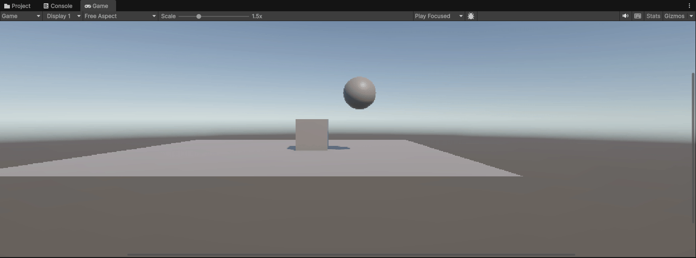

La gravedad afecta al cubo y a la esfera. La esfera cae hasta el plano sin tocar el cubo.

### 3. El plano no es un objeto físico. El cubo es un objeto físico y la esfera es cinemática. En este caso, el plano sólo tendrá collider, mientras que el cubo y la esfera deben tener Rigidbody, esta última cinemático.

La esfera es cinemática, así que la gravedad no le afecta y se queda flotando, igual que en la 1.

### 4. El plano es un objeto físico. El cubo es un objeto físico y la esfera es física. En este caso, todos los objetos deben tener Rigidbody.

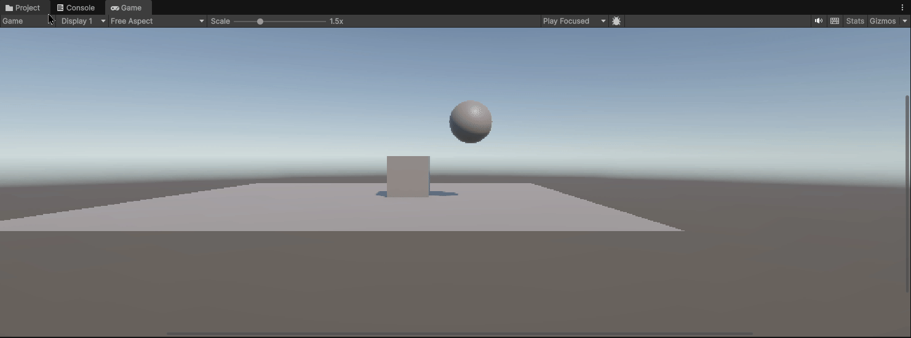

La gravedad afecta a los tres, incluido el plano. Sale un error en la consola y todo cae junto al vacío.

### 5. El plano es un objeto cinemático. El cubo es un objeto físico y la esfera es física con 10 veces más masa que el cubo. En este caso, todos los objetos deben tener Rigidbody.

El plano es cinemático, así que la gravedad no le afecta y hace de suelo. La esfera pesa 10 veces más, pero cae igual de rápido.

### 6. El plano es un objeto cinemático. El cubo es un objeto físico y la esfera es física con 100 veces más masa que el cubo. En este caso, todos los objetos deben tener Rigidbody.

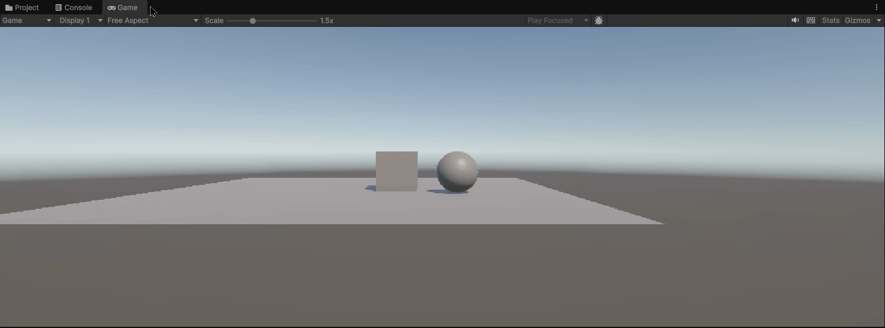

Igual que la 5. La esfera pesa 100 veces más, pero la gravedad la hace caer igual de rápido.

### 7. El plano es un objeto físico. El cubo es un objeto físico y la esfera es física con fricción. En este caso, todos los objetos deben tener Rigidbody.

Igual que la 4: la gravedad tira de todo hacia abajo, también del plano, así que no se ve la fricción.

### 8. El plano es un objeto cinemático. El cubo es un objeto físico y la esfera no es física y es Trigger. En este caso, todos los objetos deben tener Rigidbody.

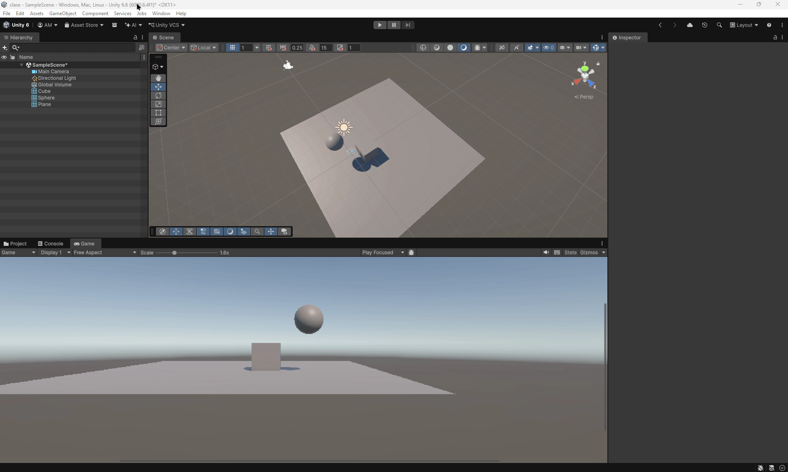

La esfera es cinemática, así que la gravedad no le afecta. Flota y, como es Trigger, no bloquea nada.

### 9. El plano es un objeto cinemático. El cubo es un objeto físico y la esfera es física y es Trigger. En este caso, todos los objetos deben tener Rigidbody.

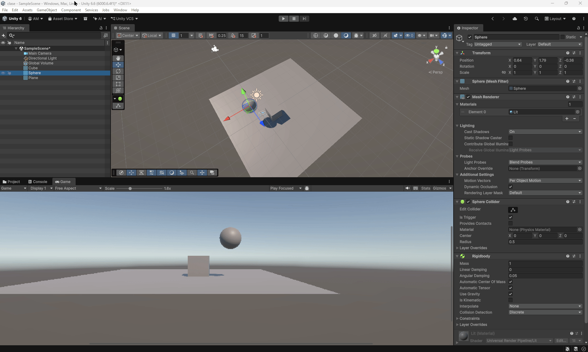

La gravedad hace caer la esfera, pero como es Trigger atraviesa el plano y sigue cayendo sin parar.

## Ejercicios

### 1. Crea un personaje, controla su desplazamiento con las teclas WASD o las flechas, el movimiento debe realizarse usando un Rigidbody, pero manteniendo el control total.

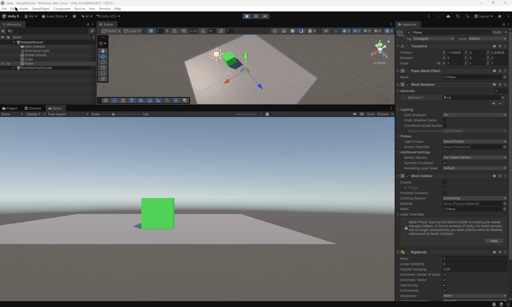

El personaje lleva un Rigidbody cinemático y se mueve con las flechas mediante `MovePosition` en `FixedUpdate`. Al ser cinemático, la gravedad no le afecta y el movimiento se controla por completo.

### 2. Crea varios cubos o esferas con Rigidbody dinámico. Muestra por consola el nombre del objeto con el que colisiona, y cámbiale su color al colisionar.

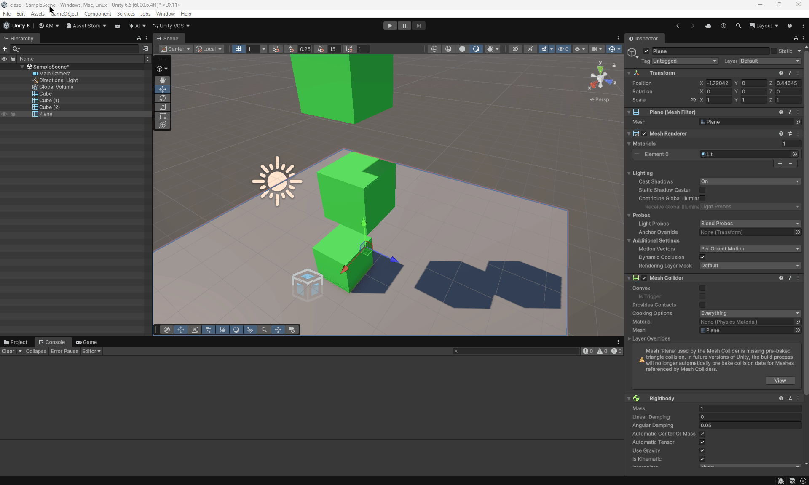

Los objetos tienen Rigidbody dinámico y están a distintas alturas para que choquen al caer. Con `OnCollisionEnter` se muestra por consola el nombre del objeto con el que colisionan y se cambia el color.

### 3. Crea una zona (por ejemplo, un cubo grande con Is Trigger = true). Al entrar, cambia el color del personaje o activa un efecto que cambie la luz. Al salir, revierte el cambio. Añade otra zona que aumente una variable daño.

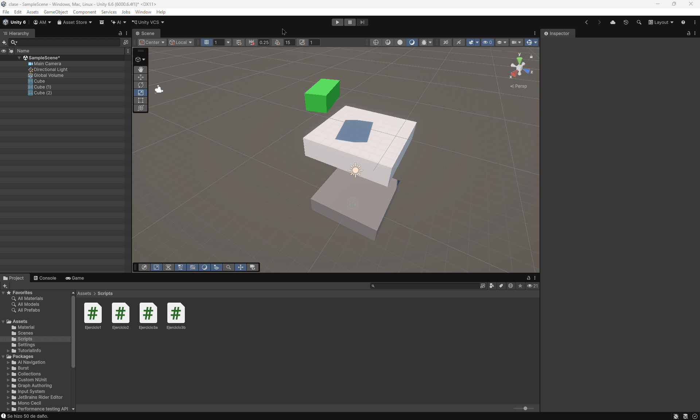

Las dos zonas son triggers. En la primera, el color cambia al entrar y vuelve al original al salir. En la segunda, al entrar se suma una sola vez un valor fijo a la variable de daño.

### 4. Crea tres tipos de objetos en capas distintas: jugador, enemigos, recolectables. Configura la Layer Collision Matrix (Project Settings > Physics). Haz que los enemigos solo colisionen con el jugador, y que los recolectables solo sean detectados por triggers.

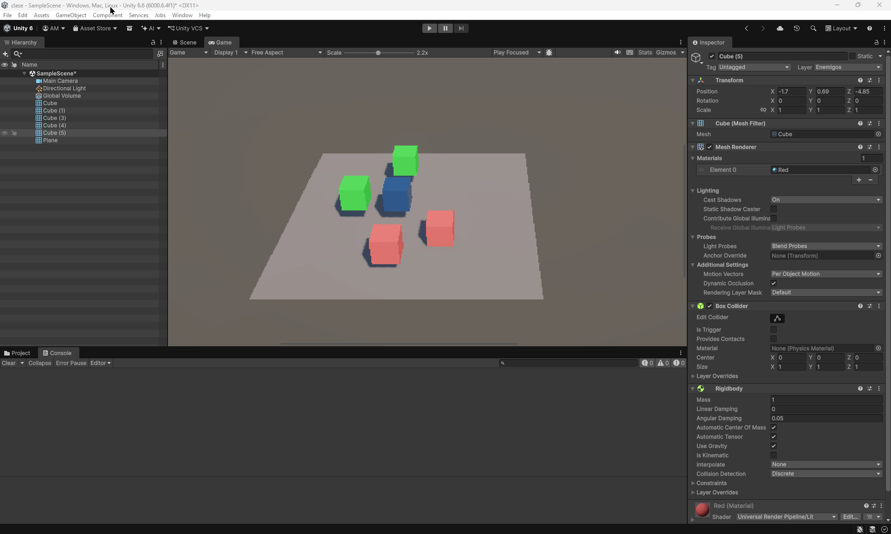

Cada tipo de objeto está en su capa. En la matriz, los enemigos solo chocan con el jugador y con el suelo, para que no caigan. Los recolectables son triggers y solo se detectan por consola.

### 5. Crea una escena con distintos materiales físicos (resbaladizo, rugoso, rebote alto). Aplica distintos Physic Materials a objetos. Lanza los objetos con AddForce() al pulsar la tecla X y observa cómo cambian las reacciones.

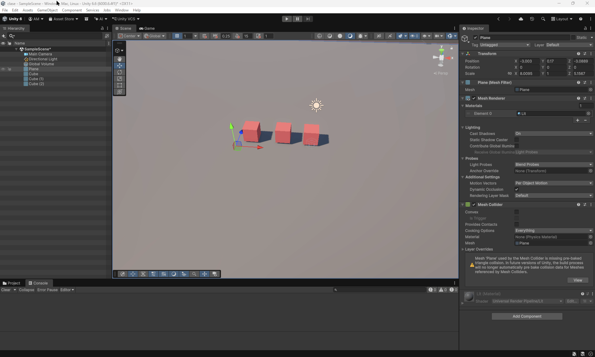

Hay tres Physics Materials: resbaladizo, rugoso y de rebote. Al pulsar X, los objetos se lanzan con `AddForce` y cada uno reacciona de forma distinta según su material.

### 6. En la escena debe haber 3 objetos que tengan Collider pero no Rigidbody. Un cubo, una esfera y un cilindro que deben estar alineados. Marcar el cilindro como objetivo a alcanzar por la esfera. El cubo debe hacer de obstáculo entre ambos. Implementar un script que haga que la esfera se dirija al cilindro, cuando la esfera alcance el cubo, este debe cambiar su material.

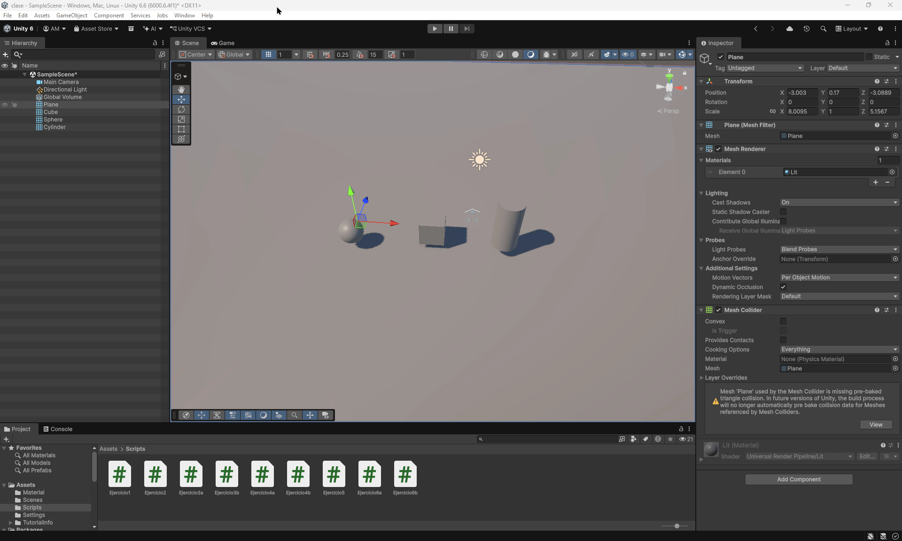

Como el enunciado pide que ningún objeto tenga Rigidbody, el trigger del cubo no salta. La esfera va hacia el cilindro y atraviesa el cubo sin que este cambie de material.